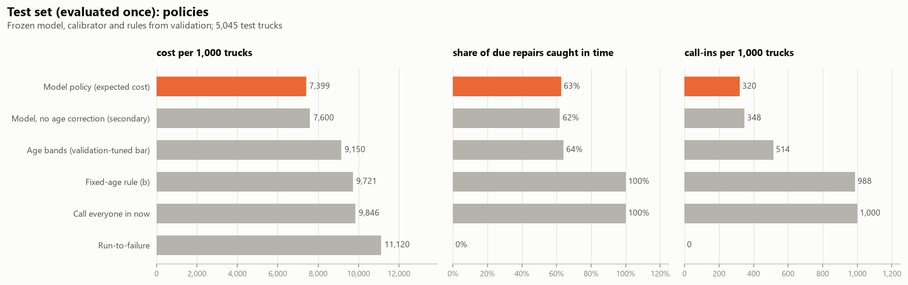
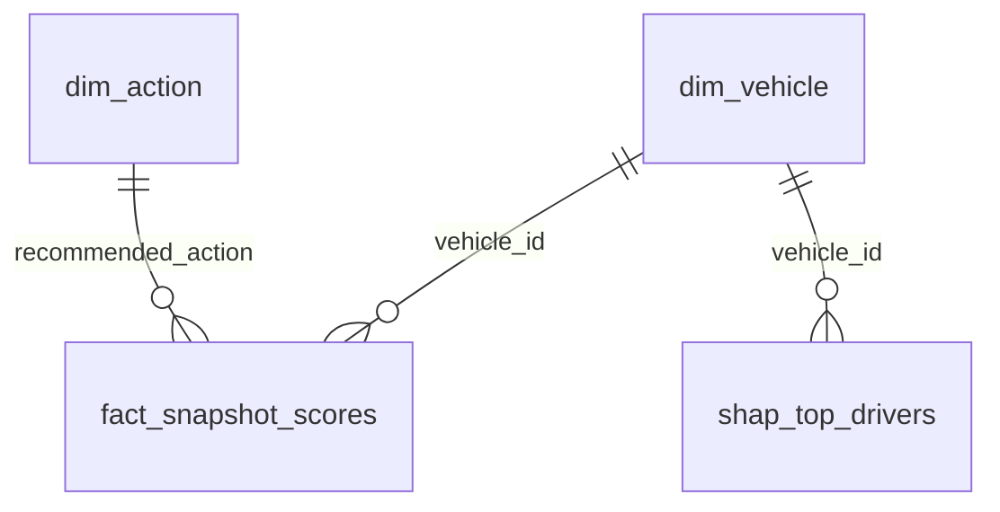

# Truck predictive maintenance: calling in the right trucks cuts the cost of Component X repairs by a quarter

**On 5,045 unseen Scania trucks, a risk-based call-in plan costs 7,399 per 1,000 trucks, against 9,846 for calling every truck in and 11,120 for waiting for breakdowns: 25% and 33% lower. It calls in a third of the fleet and catches 63% of the repairs due in time.** Costs are the expert cost matrix that ships with the data (relative units, not SEK).



## Key insights

**1. Component X wears out, and some trucks wear it out much faster.** The Weibull shape is **2.40** (95% CI 2.32–2.48), so the hazard rises with age: it is **2.6× higher** at time step 300 than at 150. **13%** of trucks are repaired by step 300 and **21%** by step 400. Specs matter: depending on the category of Spec_7 or Spec_2, between **2% and 31%** of trucks are repaired by step 300. In a Cox model the riskiest spec categories carry hazard ratios of **1.6–2.0**, and heavier early-life use of four counters adds **15–29%** hazard per standard deviation. *(notebook 02)*

**2. A missed repair is so expensive that calling every truck in beats waiting, and age alone can't do better than that.** A missed repair costs 200–500 units and an unnecessary call-in 7–10, so calling everyone in (9,823 per 1,000 trucks on validation) beats run-to-failure (11,375). The best age-only rule collapses to "call in every truck older than 65" (**9,702**, cross-validated **10,028**), no better than calling everyone in. The readouts show **which** trucks are at risk far better than **when**: the best single features separate trucks heading for a repair from matched healthy trucks with AUC 0.62–0.65, and that hardly changes in the 48 steps before the repair. *(notebooks 01, 02)*

**3. Calibrated probabilities and a cost-based decision rule matter more than the classifier.** Raw model probabilities predicted **15.5%** of trucks due when **2.7%** were. Recalibrating them cut the policy's cost by **27%** (8,955 → 6,538 on validation). Picking the most likely class is *worse* than calling everyone in, because it almost never calls a truck in. With workshop room for only **10%** of the fleet, ranking trucks by expected saving catches **36%** of due repairs and still beats calling everyone in. "Oldest trucks first" does worse than picking trucks at random. *(notebooks 03, 04)*

## Recommendation

**Call trucks in by expected saving (risk × cost of a breakdown), not by age.** With the expert costs that means about **a third of the fleet per 48-step planning window**. Start with the high-risk spec categories (Spec_7, Spec_2) and heavily used trucks.
- **If workshop slots are short,** work down the ranked list: the first 10% of the fleet delivers about two thirds of the saving.
- **If a breakdown really costs more than about 2–3× what the expert matrix assumes,** the plan stops paying and calling every truck in is as good. Revisit the cost assumption before rolling the plan out.

## Tech stack


## Method

The data is the **SCANIA Component X dataset**: anonymized readouts from 33,641 Scania heavy trucks for one engine component. 23,550 training trucks have their full history and a repair-or-censoring time; 5,046 validation and 5,045 test trucks are cut at a random readout and labelled with an urgency class. Each truck's prediction is turned into one of five planner actions, from *No action* to *Call in now*, and scored with the cost matrix Scania's experts published with the data. **Unit of analysis = truck**: every split, CV fold and metric is by vehicle. Validation is used for every choice; **test was evaluated once**, at the end of notebook 04, with everything frozen.

| Step | Question | Method |
|---|---|---|
| [SQL build](sql/) | Labels and features, no look-ahead | DuckDB: urgency class per readout with half-open windows; 80 backward-looking window features (counter rates, histogram summaries); a truncation test proves no feature uses a later readout |
| [01 EDA](notebooks/01_eda.ipynb) | What does the fleet look like, and what changes before a repair? | Readout gaps, censoring, spec mix, missingness; repaired trucks vs age- and spec-matched healthy trucks |
| [02 Reliability](notebooks/02_reliability.ipynb) | How does Component X fail over its life? | Kaplan–Meier, log-rank (Holm-corrected), Weibull, Cox PH with early-life usage (landmark) and a PH check; fixed-age baseline tuned by exact dynamic programming |
| [03 Risk model](notebooks/03_risk_model.ipynb) | How close is each truck to a repair? | Multinomial logistic regression vs `HistGradientBoostingClassifier`; vehicle-grouped CV; cross-fitted recalibration; SHAP drivers |
| [04 Policy](notebooks/04_maintenance_policy.ipynb) | What should the planner do, and what is it worth? | Expected-cost (Bayes) decision rule; sensitivity to breakdown cost and workshop capacity; one-time test with bootstrap CIs |

**Results on validation and test** (cost per 1,000 trucks, lower is better):

| Policy | Validation | Test |
|---|---|---|
| Run-to-failure | 11,375 | 11,120 |
| Call every truck in now | 9,823 | 9,846 |
| Fixed-age rule (baseline) | 9,702 | 9,721 |
| **Risk-based plan (model)** | **6,538** | **7,399** |

The test saving against calling everyone in is **2,447 per 1,000 trucks** (bootstrap 95% CI 1,214–3,665), and against the fixed-age rule **2,322** (1,094–3,529).

**Power BI data model** (star schema, built as a PBIP project with a TMDL model and a PBIR report):



`fact_snapshot_scores` is the test set as "today's fleet": calibrated class probabilities, recommended action and drivers for each truck. All relationships are single-direction. The cost matrix, survival curves, hazard ratios, calibration and policy tables are standalone. Three what-if parameters drive the DAX measures:
- **miss-cost multiplier;**
- **workshop slots per 1,000 trucks;**
- **SEK per cost unit** (illustrative).

The planner measures re-optimise every truck's action live, and `src/export_powerbi.py` checks that the default view reproduces notebook 04 exactly.

## Dashboard and outputs

- **Power BI project:** [powerbi/](powerbi/) (open `TruckPdM.pbip` in Power BI Desktop), five pages: Overview, Service plan, Cost trade-off, Reliability, Model quality
- **Service list:** [data/processed/test_service_list.csv](data/processed/test_service_list.csv), every test truck with risk, recommended action, priority and top 3 drivers
- **Notebooks:** [01 EDA](notebooks/01_eda.ipynb) · [02 Reliability](notebooks/02_reliability.ipynb) · [03 Risk model](notebooks/03_risk_model.ipynb) · [04 Policy](notebooks/04_maintenance_policy.ipynb)
- **Figures:** [docs/figures/](docs/figures/)

## How to reproduce

```powershell
py -3.12 -m venv .venv
.venv\Scripts\activate
pip install -r requirements.txt
python src/download_data.py          # ~1.65 GB from SND into data/raw/, SHA-256 checked
python src/build_dataset.py          # SQL -> data/pdm.duckdb + checks (~3 min)
python -m pytest                     # no-look-ahead test for the features
jupyter nbconvert --to notebook --execute --inplace notebooks/01_eda.ipynb notebooks/02_reliability.ipynb notebooks/03_risk_model.ipynb notebooks/04_maintenance_policy.ipynb
python src/export_powerbi.py         # tables for Power BI -> powerbi/data/
```

Notebook 03 takes about 30 minutes (model selection and SHAP); the rest take a few minutes each. Then open `powerbi/TruckPdM.pbip`, set the **DataFolder** parameter (Home → Transform data ▾ → Edit parameters) to your local `powerbi/data/` path, and click **Refresh**. (`src/build_pbip.py` generated the original project files; don't rerun it, because it would overwrite edits made in Power BI Desktop.)

## Limitations

- **Anonymized and partly perturbed data:** variable names and time are anonymized, and some values and repair rates were perturbed. `time_step` is operating time, not calendar time, so results speak about the decision method, not about named physical causes.
- **Small test signal:** each validation and test truck has a label only for its last readout, and only 142 test trucks had a repair due, hence the wide confidence intervals.
- **Validation and test differ from training:** older trucks are *less* often due there than wear-out predicts, and the data can't say why. The model's age correction learned this on validation, but it added little on test (7,399 with it, 7,600 without), so the result doesn't rest on it.
- **Costs are relative units.** SEK and downtime figures in notebook 04 and the dashboard are illustrative assumptions, labelled as such.

Data: SCANIA Component X dataset, Swedish National Data Service, https://doi.org/10.5878/bnh5-ka77, CC BY 4.0. Details and citation: [data/SOURCES.md](data/SOURCES.md).
